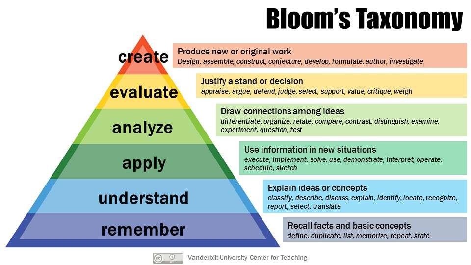

<!--
author: AILA | Fraunhofer FOKUS
email: pippow@fraunhofer.de
icon: https://upload.wikimedia.org/wikipedia/de/e/ee/Fraunhofer-Gesellschaft_2009_logo.svg
version: 0.0.1
language: de
link: https://raw.githubusercontent.com/wippo-ap/Demo-Lernziele-wirksam-formulieren/refs/heads/main/fraunhofer-liastyle-V2.css?token=GHSAT0AAAAAAERUA76CVG7PLKBG2VCY2TYC2YG5UFQ
-->
# Lernziele wirksam formulieren

Dieser kurze Selbstlernkurs zeigt, wie Lernziele klar, beobachtbar und passend zu Lernaktivitäten formuliert werden.

**Dauer:** ca. 10 Minuten  
**Zielgruppe:** Lehrende, Ausbildende und Bildungsentwickelnde

<strong>Am Ende können Sie …</strong>

<ul>
<li>Lernziele von Themen und Aktivitäten unterscheiden,</li>
<li>Lernziele mit beobachtbaren Verben formulieren und</li>
<li>Lernziel, Lernaktivität und Prüfung aufeinander abstimmen.</li>
</ul>

---
# 1. Warum Lernziele wichtig sind

Ein Lernziel beschreibt, **was Lernende nach einer Lernphase wissen, verstehen oder tun können**. Es richtet den Blick nicht auf das, was vermittelt wird, sondern auf das Ergebnis des Lernens.

Ohne klares Lernziel bleiben drei Fragen offen:

1. Was sollen Lernende erreichen?
2. Welche Aktivitäten helfen ihnen dabei?
3. Woran erkennen wir, dass das Ziel erreicht wurde?

<h2>Merksatz</h2>

Ein Thema benennt den Gegenstand. Ein Lernziel beschreibt die Leistung, die Lernende daran zeigen.

Beispiel:

- **Thema:** Datenschutz in digitalen Lernangeboten
- **Lernziel:** Lernende können drei Risiken eines digitalen Lernangebots benennen und jeweils eine Schutzmaßnahme zuordnen.

---

# 2. Lernziel, Inhalt und Aktivität unterscheiden

Diese drei Begriffe werden in der Praxis häufig vermischt:

| Begriff | Leitfrage | Beispiel |
|---|---|---|
| **Inhalt** | Worum geht es? | Präsentationsgestaltung |
| **Lernaktivität** | Was tun Lernende? | Präsentationsfolien anhand von Kriterien analysieren |
| **Lernziel** | Was können Lernende danach? | Eine Präsentationsfolie anhand von Kriterien analysieren |

„Eine Präsentationsfolie anhand von Kriterien analysieren“ kann ein Lernziel sein. „Präsentationsgestaltung“ allein ist nur ein Inhalt. „Eine Präsentation ansehen“ ist eine Aktivität, aber noch kein Lernergebnis.

Im folgenden Beispiel begegnet Ihnen die Bloom-Taxonomie: Sie ordnet kognitive Leistungen wie Erinnern und Anwenden in sechs Niveaus ein. Kapitel 5 erläutert sie genauer.

Teste Dein Wissen👌 - Welche Aussage ist als Lernziel am klarsten formuliert?

[( )] Bloom-Taxonomie
[( )] Eine Präsentation zur Bloom-Taxonomie ansehen
[(X)] Die sechs Niveaus der revidierten Bloom-Taxonomie unterscheiden und mit passenden Verben beschreiben

---

# 3. Beobachtbar und überprüfbar formulieren

Gute Lernziele enthalten ein **beobachtbares Verhalten**. Verben wie „nennen“, „vergleichen“, „entwerfen“ oder „begründen“ machen sichtbar, welche Leistung erwartet wird.

Weniger geeignet sind Verben, die im Inneren der Lernenden bleiben oder zu unspezifisch sind:

- verstehen
- wissen
- kennen
- sich mit etwas beschäftigen

Diese Verben können in einer Lernabsicht sinnvoll sein. Für ein überprüfbares Lernziel sollten sie jedoch konkretisiert werden.

<strong>Vorher:</strong> Lernende verstehen die Prinzipien guter Lernziele.

<strong>Nachher:</strong> Lernende können drei Prinzipien guter Lernziele erläutern und auf ein eigenes Beispiel anwenden.

<!-- class="fh-question" -->
Vervollständigen Sie die Aussage:

Ein gutes Lernziel beschreibt eine ______ Leistung, die ______ werden kann.

[[beobachtbare]]
[[überprüft]]

---

# 4. Die Lernziel-Formel

Eine praktische Struktur für Lernziele besteht aus drei Teilen:

1. **Verhalten:** Was tun Lernende?
2. **Bedingung:** Unter welchen Bedingungen tun sie es?
3. **Kriterium:** Wie gut oder in welchem Umfang tun sie es?

Beispiel:

> Lernende **formulieren** ein Lernziel **für ein eigenes Kursthema** **mit einem beobachtbaren Verb und einem überprüfbaren Ergebnis**.

Nicht jedes Lernziel muss alle drei Teile ausdrücklich enthalten. Die Formel hilft jedoch, unklare Formulierungen zu schärfen.

<strong>Praxis-Tipp:</strong> Fragen Sie bei jedem Lernziel: „Woran könnte eine andere Person erkennen, dass dieses Ziel erreicht wurde?“

---

# 5. Bloom-Taxonomie als Orientierung

Die revidierte Bloom-Taxonomie ordnet kognitive Leistungen von einfach zu komplex. Sie ist kein starrer Lehrplan, sondern ein Werkzeug zur Auswahl passender Verben und Aufgaben.

*Abbildung: Vanderbilt University Center for Teaching.*

| Niveau | Typische Verben | Beispiel |
|---|---|---|
| Erinnern | nennen, aufzählen | Fachbegriffe nennen |
| Verstehen | erklären, zusammenfassen | ein Modell erklären |
| Anwenden | nutzen, durchführen | ein Modell anwenden |
| Analysieren | untersuchen, unterscheiden | Bestandteile vergleichen |
| Bewerten | begründen, beurteilen | eine Lösung bewerten |
| Erschaffen | entwickeln, entwerfen | einen Lernplan entwerfen |

Wichtig: Ein höheres Niveau ist nicht automatisch besser. Das Verb muss zur angestrebten Kompetenz passen. Das Niveau hängt von der konkreten Aufgabe ab, nicht allein vom Verb.

---

# 6. Verben passend auswählen

Vergleichen Sie diese Lernziele:

- Lernende können die Merkmale eines guten Lernziels **aufzählen**.
- Lernende können ein unklares Lernziel **überarbeiten**.
- Lernende können zwei Lernziele anhand definierter Kriterien **bewerten**.

Die Ziele beziehen sich auf denselben Gegenstand, verlangen aber unterschiedliche Leistungen. Deshalb brauchen sie auch unterschiedliche Lernaktivitäten und Prüfungen.

### Zuordnung

Ordnen Sie die Tätigkeit dem passenden Bloom-Niveau zu.

„Ein Lernziel anhand einer Checkliste überarbeiten“ gehört zum Niveau …

[[Erinnern|Verstehen|(Anwenden)|Analysieren|Bewerten|Erschaffen]]

---

# 7. Abstimmung: Ziel, Aktivität und Prüfung

Ein Kurs ist stimmig, wenn Lernziel, Lernaktivität und Leistungsnachweis zusammenpassen.

<a class="fh-tile fh-tile-no-image" href="#ziel">

1 · Ziel<strong>Leistung</strong>Was sollen Lernende zeigen?

</a>
<a class="fh-tile fh-tile-no-image" href="#aktivitaet">

2 · Aktivität<strong>Übung</strong>Was lässt sie diese Leistung entwickeln?

</a>
<a class="fh-tile fh-tile-no-image" href="#pruefung">

3 · Prüfung<strong>Nachweis</strong>Woran wird die Leistung sichtbar?

</a>

Beispiel: Wenn Lernende ein Lernziel **entwerfen** sollen, reicht eine reine Wissensabfrage nicht aus. Sie brauchen eine Entwurfsaufgabe und Kriterien zur Bewertung des Entwurfs.

### Entscheidungsfrage

Das Lernziel lautet: „Lernende können ein Lernziel anhand einer Checkliste überarbeiten.“ Welche Prüfung passt am besten?

[( )] Fünf Fachbegriffe auswendig nennen
[(X)] Ein unklares Lernziel überarbeiten und die Änderungen anhand der Checkliste begründen
[( )] Einen Text über Lernziele lesen

---

# 8. Checkliste für die Praxis

Prüfen Sie jedes Lernziel mit diesen fünf Fragen:

1. Beschreibt es eine Leistung der Lernenden?
2. Ist das verwendete Verb beobachtbar?
3. Passt das Verb zum gewünschten Anspruchsniveau?
4. Ist das Ergebnis überprüfbar?
5. Passen Aktivität und Prüfung zum Lernziel?

Beispiel: Überarbeitung eines Lernziels

<strong>Unklar:</strong> Lernende verstehen gute Präsentationen.

<strong>Klarer:</strong> Lernende analysieren eine Präsentationsfolie anhand von drei Gestaltungskriterien und begründen zwei konkrete Verbesserungsvorschläge.

---

# 9. Abschluss und Transfer

Sie haben drei zentrale Ideen kennengelernt:

1. **Lernziele beschreiben Lernergebnisse**, nicht bloß Inhalte oder Aktivitäten.
2. **Beobachtbare Verben machen Leistungen überprüfbar.**
3. **Ziele, Aktivitäten und Prüfungen müssen zusammenpassen.**

### Transferaufgabe

Nehmen Sie ein eigenes Kursthema und formulieren Sie ein Lernziel. Nutzen Sie dabei diese Vorlage:

> Lernende können **[beobachtbares Verb]** **[Gegenstand oder Leistung]** unter **[Bedingung]** und erreichen dabei **[Kriterium]**.

Prüfen Sie Ihre Formulierung anschließend mit der Checkliste aus Kapitel 8.

### Abschlussquiz

Welche Aussage trifft am besten zu?

[[X]] Ein Lernziel sollte eine beobachtbare und überprüfbare Leistung beschreiben.
[[X]] Die Bloom-Taxonomie unterstützt die Auswahl passender Tätigkeitsverben.
[[ ]] Je komplexer ein Verb klingt, desto besser ist das Lernziel.
[[X]] Lernaktivität und Prüfung sollten zur angestrebten Leistung passen.

<strong>Danke für Ihre Teilnahme!</strong>

Gute Lernziele sind keine Dekoration: Sie geben Lernenden Orientierung und erleichtern die Gestaltung des gesamten Lernangebots.

